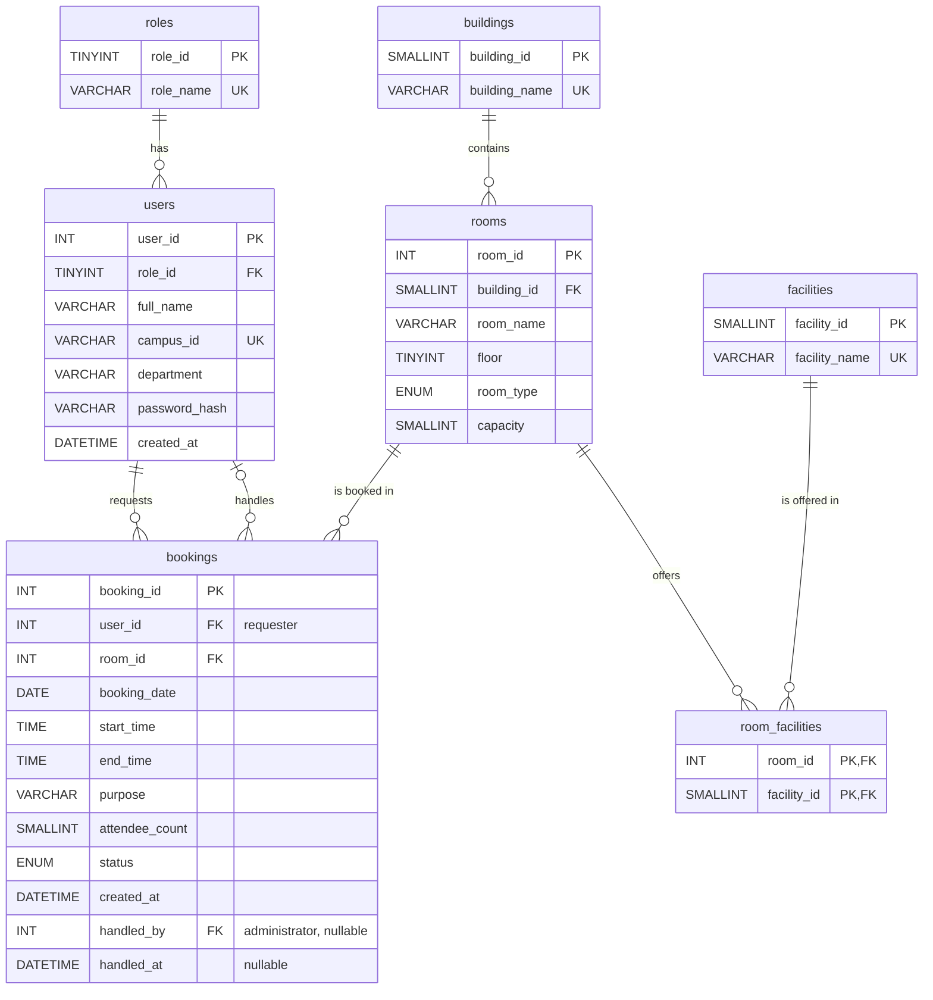

# Campus Room Booking System — Database Design Guide
**Role: Database Designer & System Logic · COMP3408 DBMS Final Project**

Everything in this guide was run and tested on MariaDB 10.11 (the same family that XAMPP ships). Files in this package:

| File | What it is |
|---|---|
| `campus_room_booking.sql` | The import file: database, 7 tables, rules (triggers), approval procedure, sample data |
| `queries.sql` | The 13 important queries (Q1–Q13) |
| `test_conflict.sql` | 13 tests for the booking rules (run one block at a time) |
| `erd.mmd` / `erd.png` | ERD in Mermaid + rendered picture |
| `DATABASE_DESIGN_GUIDE.md` | This guide |

Labels used: **[Brief]** = in the project brief · **[Rec]** = recommended design choice · **[Confirm]** = group should confirm.

---

## 0. How to import and check (do this first)

**phpMyAdmin (XAMPP):** start Apache + MySQL in the XAMPP Control Panel → open `http://localhost/phpmyadmin` → click the **Import** tab → choose `campus_room_booking.sql` → **Go**. (It creates the database itself.)

**MySQL Workbench:** File → Open SQL Script → open the file → click the lightning-bolt button.

**Command line:** `C:\xampp\mysql\bin\mysql.exe -u root < campus_room_booking.sql`

**Successful result:** the left panel of phpMyAdmin shows database `campus_room_booking` with 7 tables. Then run:

```sql
USE campus_room_booking;
SELECT (SELECT COUNT(*) FROM roles) roles, (SELECT COUNT(*) FROM users) users,
       (SELECT COUNT(*) FROM rooms) rooms, (SELECT COUNT(*) FROM facilities) facilities,
       (SELECT COUNT(*) FROM room_facilities) room_facilities,
       (SELECT COUNT(*) FROM bookings) bookings;
```
Expected: `2, 8, 8, 4, 20, 13`.

Re-importing the file **resets** the database (it drops and recreates its own tables).
Compatibility: works on MariaDB 10.4+ and MySQL 8.0.16+. If your XAMPP is old and `CHECK` is not enforced, the triggers still protect the important rules. Check yours with `SELECT VERSION();`.

---

## 1. Why the project needs a DBMS  *(Course: Database system fundamentals)*

A DBMS (database management system) is software that stores data in an organized way and controls how it is read and changed. For rooms, it gives us:
- **One shared place** to see which rooms are free (instead of messages, emails, paper).
- **Consistency:** rules the data must always obey (no negative capacity, no booking for a room that doesn't exist).
- **Controlled updates:** two admins working at the same time cannot corrupt each other's work (transactions, Section 8).

---

## 2. Data requirements and tables  *(Course: ER modelling, relational model)*

Full requirement list was in Step 1. The final tables (all columns are in the handover, Section 10):

| Table | Purpose |
|---|---|
| `roles` | The kinds of user: Requester, Administrator |
| `users` | One row per person (name, campus ID, department, role, optional password hash) |
| `buildings` | One row per building |
| `rooms` | One row per room (building, floor, type, capacity) |
| `facilities` | Equipment types: Projector, Whiteboard, TV Screen, Air Conditioning |
| `room_facilities` | Link table: which room has which facility |
| `bookings` | One row per booking request, with status and who handled it |

**Why separate tables instead of one big table?** If every booking row repeated the room's building, floor and capacity, and the user's department, a capacity change would need hundreds of edits, and missing one makes the data contradict itself. Each fact is stored once and referenced by ID (Section 4 shows this with real data).

---

## 3. ERD  *(Course: ER modelling — entities, relationships, cardinality)*




**How to read it.** Each box is a table (an *entity type* in ER terms) and each row inside is an attribute. `PK` = primary key, `FK` = foreign key, `UK` = unique. The line symbols at each end of a relationship say how many: `||` = exactly one, `o|` = zero or one, `o{` = zero or many. So `buildings ||--o{ rooms` reads: *one building contains zero or many rooms; each room is in exactly one building.*

| Relationship | Type | Why it makes sense |
|---|---|---|
| roles → users | one-to-many | A role (Requester) applies to many people; each person has one role |
| buildings → rooms | one-to-many | A building has many rooms; a room is in one building |
| rooms ↔ facilities | **many-to-many** (via `room_facilities`) | A room has several facilities; a facility type is in many rooms |
| users → bookings (requests) | one-to-many | A user makes many bookings; each booking has exactly one requester |
| users → bookings (handles) | one-to-many, optional | An admin handles many bookings; a booking has 0 or 1 handler (none while Pending) |
| rooms → bookings | one-to-many | A room has many bookings over time |

`users` appears twice towards `bookings` because the same entity type plays two **roles** (requester and administrator) — the same idea as "Andi reports to Rudi" in your week 2 slides.
Relational model note: a many-to-many relationship cannot be stored directly in a table, so it becomes its own table (`room_facilities`) whose primary key is the *pair* of foreign keys.

---

## 4. Functional dependencies and normalization  *(Course: FD, 1NF–3NF)*

A **functional dependency** `X → Y` means: if you know X, there is exactly one possible Y. Real FDs in our data:

- `room_id → room_name, building_id, floor, room_type, capacity`
- `(building_id, room_name) → room_id` (a room name is unique inside one building)
- `building_id → building_name`
- `user_id → full_name, campus_id, department, role_id` and `campus_id → user_id`
- `role_id → role_name`
- `facility_id → facility_name`
- `booking_id → user_id, room_id, booking_date, start_time, end_time, purpose, attendee_count, status, created_at, handled_by, handled_at`

### 4.1 The messy table (what we avoid)

Imagine one table `booking_raw` with `booking_id` as key:

| booking_id | requester | campus_id | department | room | building | floor | capacity | facilities | date | start | end | status | admin |
|---|---|---|---|---|---|---|---|---|---|---|---|---|---|
| 1 | Aldo | S2026001 | Computer Science | Study Room L1 | Library Building | 1 | 6 | Whiteboard, Air Conditioning | 11-24 | 09:00 | 11:00 | Approved | Dewi |
| 2 | Bella | S2026002 | Computer Science | Study Room L1 | Library Building | 1 | 6 | Whiteboard, Air Conditioning | 11-24 | 10:00 | 12:00 | Pending | |
| 3 | Aldo | S2026001 | Computer Science | Study Room L1 | Library Building | 1 | 6 | Whiteboard, Air Conditioning | 11-27 | 13:00 | 14:00 | Pending | |

Problems (the "evils of redundancy" from your FD lecture):
- **Update anomaly:** if L1's capacity becomes 8, every L1 row must change. Miss one and the capacity check gives two different answers. Same for a department rename.
- **Insert anomaly:** a new room can't be recorded until someone books it. A new building can't exist without a room.
- **Delete anomaly:** deleting the only booking of a room deletes the room's information.
- **Inconsistent spelling:** "Library Building" vs "Library Bldg" splits one building in two in the reports.

### 4.2 1NF — atomic values, a key, no repeating groups
`facilities` holds a list ("Whiteboard, Air Conditioning") — not atomic. A facility must be one value per row. Fix: move facilities to their own rows. Every table has a primary key.

### 4.3 2NF — no partial dependency on part of a composite key
If we store room–facility rows as `(room_id, facility_id, room_name, capacity, facility_name)`, the key is the pair, but `room_name, capacity` depend on `room_id` alone and `facility_name` on `facility_id` alone — partial dependencies. Fix: `rooms`, `facilities` and a link table `room_facilities(room_id, facility_id)` that holds *only* the key pair.

### 4.4 3NF — no non-key attribute depends on another non-key attribute
In `booking_raw`: `booking_id → room_id → building_id → building_name`, and `booking_id → user_id → role_id → role_name`. These are transitive chains (key → non-key → non-key). Fix: cut the chain at each non-key determinant and give it its own table: `rooms`, `buildings`, `users`, `roles`.

### 4.5 Result
| Table | Key | Every non-key column depends on… |
|---|---|---|
| `roles` | `role_id` | the key only |
| `users` | `user_id` (also `campus_id`) | the key only |
| `buildings` | `building_id` | the key only |
| `rooms` | `room_id` (also `(building_id, room_name)`) | the key only |
| `facilities` | `facility_id` | the key only |
| `room_facilities` | `(room_id, facility_id)` | (no other columns) |
| `bookings` | `booking_id` | the key only |

So all tables are in 1NF, 2NF and 3NF: in each one, every determinant is a key. The anomalies are gone: L1's capacity lives in exactly **one** row (`rooms`), and a room exists without any bookings.

Notes: `department` stays a plain column of `users` **[Rec]** because nothing else depends on it (`department → ?` has no other attribute), so no transitive dependency exists. `room_type` and `status` are single values from fixed lists (`ENUM`). I stopped at 3NF as requested; 4NF/5NF do not apply because there are no independent multi-valued facts besides the one the link table already separates.

---

## 5. Relational algebra and calculus, in our database  *(Course: relational algebra / calculus)*

**Relational algebra** = step-by-step operations: **σ** (selection: pick rows), **π** (projection: pick columns), **⋈** (join: combine tables by matching keys), **−** (difference).

| Idea | Algebra | SQL (from `queries.sql`) |
|---|---|---|
| Rooms with building name (Q1) | π room_name, building_name, floor, room_type, capacity ( rooms ⋈ buildings ) | `SELECT … FROM rooms r JOIN buildings b ON …` |
| Approved bookings only | σ status='Approved' ( bookings ) | `WHERE status = 'Approved'` |
| Available rooms (Q3) | rooms − π rooms.\* ( rooms ⋈ σ(status='Approved' ∧ date=d ∧ start<end₀ ∧ end>start₀)(bookings) ) | `WHERE NOT EXISTS (…)` |

**Relational calculus** = *describe* what you want, not how to get it. Availability in tuple-calculus style:

`{ r | r ∈ rooms ∧ ¬∃ b ( b ∈ bookings ∧ b.room_id = r.room_id ∧ b.status = 'Approved' ∧ b.booking_date = d ∧ b.start_time < e ∧ b.end_time > s ) }`

"All rooms r such that there does **not exist** an overlapping approved booking b." That is exactly `NOT EXISTS` in SQL — the query states the condition, and MySQL decides how to find the answer.

---

## 6. SQL implementation  *(Course: SQL & relational implementation)*

`campus_room_booking.sql` contains everything: `CREATE TABLE` with primary keys, foreign keys, `NOT NULL`, `UNIQUE`, `CHECK`, indexes (comments explain each), and the sample data. `queries.sql` shows insert, select, update, joins, filtering, grouping and reports.

Quick reference of the 13 queries (the PHP backend supplies the values in the right column; in PDO write them as `:name` placeholders):

| # | What it does | Feature | PHP supplies |
|---|---|---|---|
| Q1 | All rooms + building, floor, type, capacity | Room list | – |
| Q2 | Facilities per room | Room details | (`room_id` for one room) |
| Q3 | Rooms free for date + time (+ enough capacity) | Availability search | date, start_time, end_time, attendees |
| Q4 | Insert a Pending booking | Booking form | user_id (session), room_id, booking_date, start_time, end_time, purpose, attendee_count |
| Q5 | A user's bookings + status | My bookings | user_id (session) |
| Q6 | Pending requests, oldest first, flags clashes | Admin review | – |
| Q7 | Approve with conflict check (`CALL sp_approve_booking`) | Approve button | booking_id, admin_id (session) |
| Q8 | Reject + record admin | Reject button | booking_id, admin_id |
| Q9 | Cancel own booking | Cancel button | booking_id, user_id (session) |
| Q9b | Mark finished bookings Completed | Run at page load | – |
| Q10 | History grouped Past / Upcoming / Cancelled | History page | user_id |
| Q11 | Bookings per department | Report | – |
| Q12 | Most-used rooms (Approved + Completed) | Report | – |
| Q13 | Bookings per week (week starts Monday) | Report | – |

Report definitions are **[Rec]**: "used" means Approved or Completed; department/week counts include all statuses with a status breakdown.

---

## 7. The overlap rule  *(Course: constraints; relational calculus idea)*

Two bookings in the same room on the same date conflict when:

`existing_start < requested_end AND existing_end > requested_start`

Example, room L1 tomorrow, existing Approved 09:00–11:00:

| Request | 09:00 < req_end ? | 11:00 > req_start ? | Conflict? |
|---|---|---|---|
| 10:00–12:00 | yes | yes | **Yes** |
| 08:00–09:30 | yes | yes | **Yes** |
| 11:00–13:00 | yes | 11:00 > 11:00 **no** | No (back-to-back allowed **[Confirm]**) |
| 07:00–09:00 | 09:00 < 09:00 **no** | – | No |

A plain `CHECK` constraint can only look at **one row**; overlap compares **different rows**, so `CHECK` cannot enforce it. We use a trigger (a rule that runs automatically before an insert/update) plus a transaction.

---

## 8. Conflict logic and transactions  *(Course: transactions)*

### 8.1 The problem: a race condition
Admin A and Admin B approve two overlapping requests at the same moment:
1. A checks: no approved booking in the way ✔
2. B checks: no approved booking in the way ✔ (A hasn't saved yet)
3. A saves Approved. B saves Approved. → **double booking.**

**Experiment I ran** (two simultaneous sessions, 3-second delay between "check" and "save"):
- *Without the room lock:* both #14 (10:00–12:00) and #15 (11:00–13:00) became **Approved**. ✗
- *With `sp_approve_booking`:* the second admin got `Conflict: room already has an Approved booking in this time slot`, and #17 stayed Pending. ✔

### 8.2 The solution (simple and reliable for InnoDB)
A **transaction** groups steps so they all succeed (**COMMIT**) or all are undone (**ROLLBACK**). Approval is one transaction:

```
START TRANSACTION
  lock the booking row           (SELECT … FOR UPDATE)
  lock the ROOM row              (SELECT … FOR UPDATE)  ← others approving this room must wait here
  check: status is Pending, time not already past
  UPDATE status = 'Approved'     → trigger checks capacity, admin role, overlap
COMMIT                           (or ROLLBACK + error if anything failed)
```
Locking the *room* row works as a turnstile: only one approval per room at a time. The second admin waits, then sees the first admin's committed booking and is refused. (Locking only the booking row is not enough, because the two requests are different rows.) The procedure uses `READ COMMITTED` so the check sees the freshest committed data.

Defence in depth: the triggers `trg_bookings_before_insert/update` run the same checks even if someone writes a plain `UPDATE` or `INSERT` (Tests 4 and 5). Be aware: the trigger alone cannot stop two simultaneous writes — the lock in the procedure is what does. **So the backend must approve only through `sp_approve_booking`.**

### 8.3 What the PHP backend does (pseudocode)
```php
// admin page, after checking $_SESSION role is Administrator
try {
    $stmt = $pdo->prepare('CALL sp_approve_booking(:booking_id, :admin_id)');
    $stmt->execute([':booking_id' => $bookingId, ':admin_id' => $_SESSION['user_id']]);
    $stmt->closeCursor();
    $message = 'Booking approved.';
} catch (PDOException $e) {
    // SQLSTATE 45000 = one of OUR rule messages (conflict, not Pending, ...)
    $message = ($e->errorInfo[0] === '45000') ? $e->errorInfo[2] : 'Unexpected database error.';
}
```
Set the PDO option `PDO::ATTR_ERRMODE => PDO::ERRMODE_EXCEPTION`.

### 8.4 What happens on a conflict
The procedure's error handler runs `ROLLBACK`, nothing is changed, and PHP receives the error text to show to the admin. The booking stays Pending so the admin can reject it.

### 8.5 Test results (from `test_conflict.sql`, fresh data)
| Test | Action | Result |
|---|---|---|
| 1 | Approve #2 (overlaps Approved #1) | ✗ `Conflict: room already has an Approved booking…`; #2 stays Pending |
| 2 | Approve #3 (11:00–13:00, back-to-back with #1) | ✔ Approved |
| 3 | Approve #6 (different room) | ✔ Approved |
| 4 | Plain UPDATE approving overlapping #5 | ✗ blocked by trigger |
| 5 | INSERT overlapping Approved row | ✗ blocked by trigger |
| 6 | INSERT another Pending for the same slot | ✔ allowed |
| 7 | 7 attendees in a 6-seat room | ✗ `Attendee count exceeds the room capacity` |
| 8 | end_time = start_time | ✗ `chk_bookings_time_order` |
| 9 | attendee_count = 0 | ✗ `chk_bookings_attendees` |
| 10 | room_id 999 | ✗ foreign key error 1452 |
| 11 | Requester as handler | ✗ `handled_by must be a user with the Administrator role` |
| 12 | Approve twice / Rejected → Approved | ✗ `Only Pending bookings can be approved` / `Invalid status change` |
| 13 | Cancel someone else's booking | 0 rows changed |
| Final | Overlap-detector query over Approved rows | 0 rows ✔ |

### What course lesson this demonstrates
**Transactions:** atomic approval, COMMIT/ROLLBACK, locking, and a real demonstration of the concurrency problem and its fix. **Constraints:** `CHECK`, `FOREIGN KEY`, `UNIQUE`, `NOT NULL` doing their job in Tests 7–10.

---

## 9. Data validation and integrity checklist

**Database enforces (cannot be bypassed by a buggy page):**
| Rule | How |
|---|---|
| End time later than start time | `CHECK chk_bookings_time_order` |
| Attendees is a positive number | `CHECK chk_bookings_attendees` |
| Attendees ≤ room capacity | trigger → `sp_validate_booking` (compares with another table) |
| Booking has an existing requester and room | foreign keys |
| Handler is a valid user **with Administrator role** | foreign key + trigger |
| Only valid statuses stored | `ENUM` |
| Approved/Rejected must record the admin | trigger |
| Only Approved blocks a slot; no overlapping Approved bookings for one room | trigger + `sp_approve_booking` lock |
| No invalid repeats (Pending → Approved/Rejected/Cancelled; Approved → Cancelled/Completed; the rest are final) | `trg_bookings_before_update` |
| Capacity > 0, unique building/room names, unique campus ID | `CHECK`, `UNIQUE` |
| `handled_by` and `handled_at` filled together | `CHECK chk_bookings_handled_pair` |
| History is never lost (users/rooms with bookings cannot be deleted) | foreign keys without cascade |

**PHP must check (the database cannot know these):**
| Rule | Why PHP |
|---|---|
| The user is logged in and the role is Administrator for approve/reject/manage rooms | Session/login is application state |
| `user_id` for a new booking and for cancelling comes from the **session**, not the form | Stops users acting as someone else |
| A requester cancels **only their own** booking | Done in the `WHERE user_id = :user_id` of Q9; PHP checks `rowCount()` |
| Cancellation timing rule (default: before start time) | Q9 includes it; change here if the group sets a notice period |
| New booking date is not in the past; time inputs well-formed | Friendly messages before hitting the database |
| Show readable error text; use PDO prepared statements always | Security (SQL injection) and usability |
| Run Q9b (set Completed) when pages load | No scheduler in XAMPP |
| Hash passwords with `password_hash()` / check with `password_verify()` | Never store plain text |

---

## 10. HANDOVER — for the backend developer and group

**Database name:** `campus_room_booking` (utf8mb4, InnoDB)
**SQL file:** `campus_room_booking.sql` — import via phpMyAdmin (Import tab) or `mysql -u root < campus_room_booking.sql`. XAMPP default: user `root`, empty password, host `localhost`. Re-importing resets the data.
**PDO DSN:** `mysql:host=localhost;dbname=campus_room_booking;charset=utf8mb4`

### Tables, columns, types
**roles** — `role_id` TINYINT UNSIGNED PK AI · `role_name` VARCHAR(20) UNIQUE NOT NULL (`Requester`, `Administrator`)

**users** — `user_id` INT UNSIGNED PK AI · `role_id` TINYINT UNSIGNED FK→roles · `full_name` VARCHAR(100) · `campus_id` VARCHAR(20) UNIQUE · `department` VARCHAR(100) · `password_hash` VARCHAR(255) NULL · `created_at` DATETIME default now

**buildings** — `building_id` SMALLINT UNSIGNED PK AI · `building_name` VARCHAR(100) UNIQUE

**rooms** — `room_id` INT UNSIGNED PK AI · `building_id` SMALLINT UNSIGNED FK→buildings · `room_name` VARCHAR(50) · `floor` TINYINT UNSIGNED · `room_type` ENUM('Study Room','Classroom') · `capacity` SMALLINT UNSIGNED (>0) · UNIQUE(`building_id`,`room_name`)

**facilities** — `facility_id` SMALLINT UNSIGNED PK AI · `facility_name` VARCHAR(50) UNIQUE

**room_facilities** — `room_id` INT UNSIGNED + `facility_id` SMALLINT UNSIGNED, together the PK, both FKs (ON DELETE CASCADE)

**bookings** — `booking_id` INT UNSIGNED PK AI · `user_id` INT UNSIGNED FK→users (requester) · `room_id` INT UNSIGNED FK→rooms · `booking_date` DATE · `start_time` TIME · `end_time` TIME · `purpose` VARCHAR(255) · `attendee_count` SMALLINT UNSIGNED (>0) · `status` ENUM('Pending','Approved','Rejected','Cancelled','Completed') default `Pending` · `created_at` DATETIME default now · `handled_by` INT UNSIGNED NULL FK→users (admin) · `handled_at` DATETIME NULL

### Relationships
roles 1—M users · buildings 1—M rooms · rooms M—M facilities (`room_facilities`) · users 1—M bookings (`user_id`, requester) · users 1—M bookings (`handled_by`, admin, optional) · rooms 1—M bookings.

### Creating a booking — required fields
`user_id` (from login session), `room_id`, `booking_date` (`YYYY-MM-DD`), `start_time` (`HH:MM:SS`), `end_time`, `purpose`, `attendee_count`.
**Do not send** `status`, `created_at`, `handled_by`, `handled_at`: defaults make it `Pending`.

### Status values (exact spelling, capital first letter)
`Pending`, `Approved`, `Rejected`, `Cancelled`, `Completed`. Allowed changes: Pending → Approved / Rejected / Cancelled; Approved → Cancelled / Completed. Rejected, Cancelled and Completed are final.

### How approval works
Approve **only** with `CALL sp_approve_booking(:booking_id, :admin_id)`. It locks the room, checks the overlap rule (existing_start < new_end AND existing_end > new_start, same room, same date, Approved only), then commits. On failure it rolls back and raises SQLSTATE `45000` with a readable message in `$e->errorInfo[2]` — show it to the admin. Reject, cancel and complete use the plain `UPDATE` statements in `queries.sql` (Q8, Q9, Q9b); check `rowCount()`.

### Error messages the database can raise (SQLSTATE 45000)
`Conflict: room already has an Approved booking in this time slot` · `Attendee count exceeds the room capacity` · `handled_by must be a user with the Administrator role` · `Approved or Rejected bookings need handled_by` · `Invalid status change for this booking` · `Only Pending bookings can be approved` · `Cannot approve a booking whose time has already passed` · `Booking not found`.
Check-constraint and foreign-key errors have other codes (4025/3819 and 1452).

### Sample logins
Users have no passwords (`password_hash` is NULL). Admins: `user_id` 1 and 2. Requesters: 3–8. The login page developer must add a way to set a hash, e.g. run `password_hash('your-demo-password', PASSWORD_DEFAULT)` once in PHP and `UPDATE users SET password_hash = ? WHERE user_id = ?`.

### Assumptions made (Step 1 defaults — **[Confirm]** with group)
1. One user may hold overlapping bookings in different rooms.
2. Owner may cancel Pending or Approved bookings before start time; no notice period.
3. Admins can add/edit rooms and facilities in the app (database supports it).
4. A rejected/cancelled request is not reopened; submit a new booking.
5. `handled_at` is stored; no rejection reason.
6. Password stored as `password_hash` (hash only).
7. No maintenance/blocked-room feature.
8. `Completed` is a stored status updated by Q9b.
9. `department` is a text column on `users`.
10. `room_type` and `status` are `ENUM`s.
Also added by me (confirm): back-to-back bookings are allowed; an already-passed booking cannot be approved; users are created by an admin/seed script (no self-registration page was specified).

---

## 11. Course topics intentionally not used
Object-oriented DBMS, vector databases and distributed DBMS/transactions are outside this project's chosen model: it is a single relational MySQL application, so adding them would only be decoration. (If your instructor asks, the distributed-transaction idea is a bigger version of the same commit/rollback concept used in Section 8.)

---

## 12. Definition-of-done check for my role
- [x] Explain every table (Section 2, 10)
- [x] Show the ERD and relationships (Section 3)
- [x] Explain duplicate-data avoidance (Section 4)
- [x] Import and run the script (tested; Section 0)
- [x] Sample data (in the SQL file)
- [x] Run the important queries (`queries.sql`, all executed)
- [x] Overlapping approved bookings cannot be created (Section 8.5)
- [x] Explain how transactions prevent conflicting approvals (Section 8.1–8.2, with experiment)
- [x] Handover for the backend developer (Section 10)

**Before the demo:** run `SELECT VERSION();` in your XAMPP, import the file once on that machine, and run the checks in Section 0 and `test_conflict.sql` there, because I tested on MariaDB 10.11, not on your exact install.
